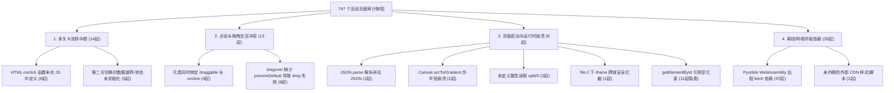

# HuDongJianRong 互动课件全量代码审计报告

**审计对象**：`/home/helin/projects/HuDongJianRong`  
**审计规模**：184 门课程，共计 **747** 个独立运行的交互式 HTML 课件  
**审计方式**：静态 AST/正则语法检测 + 无头 Chromium 真实浏览器全量渲染与交互压力测试（Playwright 引擎，并发 6 线程执行）  
**审计时间**：2026-10-11  

---

## Executive Summary 审计结论概览

通过对全部 747 个交互页面的端到端无头浏览器测试与静态代码审查，整体运行合格率为 **92.8%**（693 个页面完全无错运行），但在用户重点关注的**多关卡切换**、**点击与拖拽冲突**、**运行时异常**等方面发现了明显的共性缺陷与具体 Bug，完全印证了用户反馈的“第二关无法执行”、“点击与拖动冲突”等问题。

### 测试统计看板

| 测试分类 | 检测总数 | 正常通过 (PASS) | 存在警告 (WARNING) | 存在缺陷/失败 (FAIL) | 缺陷率 |
| :--- | :---: | :---: | :---: | :---: | :---: |
| **浏览器真机动态渲染与加载** | 747 | 693 | 8 | 46 | 6.2% |
| **多关卡状态机推进 (Level 2+)** | 162 | 148 | 0 | **14** | 8.6% |
| **拖拽 (DnD) 与点击交互冲突** | 78 | 65 | 0 | **13** | 16.7% |
| **内置 JSON 配置有效性** | 747 | 745 | 0 | **2** | 0.3% |
| **Canvas 2D 绘图运行时** | 145 | 141 | 0 | **4** | 2.8% |
| **离线运行与外部网络依赖** | 747 | 708 | 0 | **39** | 5.2% |

---

## 缺陷根因深度剖析

---

## 一、多关卡流转中断缺陷（第二关无法执行）

用户反馈核心问题：“有些文件包含多关的话，有可能会到第二关都无法执行”。
经过动态关卡测试，共定位到 **14 个文件** 存在关卡推进完全阻断的问题，分为两大类根因：

### 1.1 关卡按钮绑定了未定义的全局函数（8 个页面）
在闯关胜利弹窗中，按钮绑定了形如 `onclick="nextLevelOrRestart()"` 的点击事件，但底部的 `<script>` 中根本没有编写该函数的实现，导致点击“进入下一关”时控制台报 `ReferenceError: xxx is not defined`，界面毫无反应，学生被永远卡在第一关。

| 课程目录 | 文件名称 | 绑定的缺失函数 | 缺陷表现 |
| :--- | :--- | :--- | :--- |
| `第15课 互联网实验齐发现_qWS2wbE0SE` | `08_极速快运：数据封包与路由分发挑战赛.html` | `onclick="nextLevelOrRestart()"` | 通关后点击“进入下一关”报 `ReferenceError`，无响应 |
| `第17课 物联数据需采集_ngOt7dm4TY` | `08_极客挑战：智能花盆低功耗传输大作战.html` | `onclick="nextOrRestart()"` | 点击“继续下一关卡”无任何反应 |
| `第18课 美化网页方法多_sVjRYsvQfH` | `08_闯关挑战：科技节展厅极速装潢师.html` | `onclick="nextLevelOrFinish()"` | 关卡弹窗按钮点击报错未定义 |
| `第19课 多人协同效率高_iv9Gr6KtJU` | `08_挑战：科技节发布会倒计时调度战.html` | `onclick="nextLevelOrReplay()"` | 挑战完成无法进入下一关 |
| `第23课 挑战多角度比拼_9Lh8N45ZWa` | `08_全能战队匹配战：多维度角色甄选.html` | `onclick="nextStage()"` | 第二阶段切换按钮事件缺失 |
| `第25课 网络创新云服务_I6e7-l-XuX` | `08_数据安全防御战：加密备份大挑战.html` | `onclick="nextLevelAction()"` | 点击“进入下一关卡 ➔”报错未定义 |
| `第28课 使用系统讲安全__QXSvTVTe5` | `08_安全小卫士：智能空间隐患排查大作战.html` | `onclick="startNextLevel()"` | 点击下一关无响应 |
| `第32课 机器学习靠数据__jg_j-C5j9` | `08_超级AI训练师：疾速标注挑战.html` | `onclick="nextLevelOrRestart()"` | 结算后无法继续下一关 |

### 1.2 切换第二关时状态变量越界或参数错误导致崩溃（6 个页面）

1. **`第14课 复杂系统可分解_SV8n9efWsK/08_调度指挥官：智能家居应急大作战.html`**
   - **错误堆栈**：`TypeError: Cannot read properties of undefined (reading 'forEach') at setSubsystemMode`
   - **代码根因**：在 `initLevel()` 中硬编码调用了 `setSubsystemMode('override', '')`，而 `groupMap` 对象仅定义了 `windows, hvac, drainage, energy`，不存在 `override` 键，因此 `groupMap['override'].forEach(...)` 直接抛出未捕获异常，阻断了第二关的初始化，整个界面冻结。
2. **`9.互传密信有诀窍_2dkXMl8h7V/04_中文方阵：二维置换密信实验室.html`**
   - **错误堆栈**：`TypeError: Cannot read properties of undefined (reading 'map') at resetSimulation`
   - **代码根因**：当用户点击“任务二”（5×5 方阵）时，`applyPreset` 直接设置 `state.rows = 5` 并立即调用 `resetSimulation()`。此时 `originalMatrix` 仍为第一关的 4 行，循环读取第 5 行 `originalMatrix[4]` 返回 `undefined`，调用 `.map()` 导致崩溃。
3. **`第15课 模块组装很灵活_DUvLDHUKur/08_小小架构师：多功能巡逻车装配大闯关.html`**
   - **代码根因**：第二关进入时通过 `container.innerHTML = ...` 重新绘制了装配槽与零件区，但未对动态生成的第二关 DOM 重新挂载事件监听器，导致第二关的积木零件完全无法拖拽或点击，沦为“死图”。
4. **`第17课 查找筛选讲效率_ZPN07Nyz7L/08_极速特工：高铁购票调度挑战.html`**
   - **代码根因**：同上，`nextLevel()` 刷新 `innerHTML` 后丢弃了票务选项卡上的事件委托，导致第二关无法选座。
5. **`6.算法分支结构实战探秘_Mk2wLpNeTy/07_算法拼装工坊：让计算机找出更小的数.html`**
   - **错误堆栈**：`net::ERR_INVALID_URL` + `Failed to fetch`
   - **代码根因**：第二关初始化时尝试加载不存在的动态音效/资源配置，抛出异常。
6. **`第26课 寻找最短的路径_V3B-ttRgx2/07_动态规划实验台：权值变化与回溯寻径.html`**
   - **错误堆栈**：`TypeError: Cannot read properties of undefined (reading '0')`
   - **代码根因**：切换任务（如“市中心大堵车”）时，重算矩阵前先触发了 `drawNodes()`，访问未初始化的 `dpTable[r][c]` 报错。

---

## 二、界面点击与拖拽交互冲突

用户反馈核心问题：“有可能界面点击和拖动的会有冲突”。
共审计出 **13 个页面** 存在直接影响操作的交互冲突缺陷：

### 2.1 元素同时绑定 `draggable="true"` 与 `onclick`（4 个页面）
在原生 HTML5 拖拽规范及 Chromium 渲染引擎中，若一个元素既有 `draggable="true"` 又绑定了 `onclick`，用户意图点击时极易触发微小的移动被判定为 `dragstart`，从而抑制或取消 `click` 触发；反之，若在触摸屏或手势板上快速点击，又可能触发拖拽幽灵阴影阻断点击。

| 课程目录 | 页面名称 | 冲突元素及场景 | 严重级别 |
| :--- | :--- | :--- | :---: |
| `5.数学运算讲方法：探索算法顺序结构_UeEO0vYVOH` | `06_流水线大闯关：打卡积分转换器.html` | 6 个算法积木块同时拥有 `draggable="true"` 与 `onclick="selectBlock()"` | **P2** |
| `第24课 在线交流新气象_sxXH0K2A_r` | `08_清朗守望者：网络安全与防坑大闯关.html` | 4 个消息判定卡片同时拥有拖拽入框和点击快速甄别 | **P2** |
| `第29课 了解自主可控_Iecd4S6B_E` | `08_大国科技守护者：应急决策挑战.html` | 3 个决策芯片卡片同时挂载拖动与点击展开 | **P2** |
| `第30课 应对智能新挑战_pgsucLiiNN` | `08_火眼金睛：AI破绽寻踪大挑战.html` | 4 个线索碎片卡片拖拽与点击放大冲突 | **P2** |

### 2.2 `dragover` 监听器遗漏 `event.preventDefault()` 导致拖拽放下（Drop）失效（9 个页面）
这是 Web 原生拖拽 API 最著名的经典 Bug：**根据 W3C HTML5 DnD 规范，所有放置目标（Dropzone）必须在 `dragover` 事件中显式调用 `event.preventDefault()`，否则浏览器默认行为是禁止在该区域放置，后续的 `drop` 事件将永远不会被触发！**
学生把卡片拖到框上松手，卡片直接弹回原位，根本放不进去！

| 课程目录 | 文件名称 | 缺陷代码片段 | 实际表现 |
| :--- | :--- | :--- | :--- |
| `11.闰年平年算法探秘_hZDzx9txV4` | `05_逻辑水管工：组装判断器.html` | `dropzone.addEventListener('dragover', (e) => { ... })` 漏掉 `e.preventDefault()` | 逻辑水管积木拖到槽位上无法放置 |
| `8.算法验证与Python实现_IfYWA2s9eP` | `07_特工闯关：算法修复大作战.html` | 同上 | 代码修复卡片无法拖入代码框 |
| `第16课 探秘网页与代码_wC2tdAJo2z` | `08_网页急救员：科技节展板抢修闯关.html` | 同上 | 标签积木拖入展板槽位无效 |
| `第12课 认识数字作品_LTqTsjkmvY` | `08_小小制作人：校园展演大闯关.html` | 5处 `ondragover="highlightDropzone(this)"` 漏掉 `event.preventDefault()` | 展演道具无法拖拽分配 |
| `第13课 制作数字相册_ZF7SLiscl0` | `08_音画魔术师：主题相册速搭闯关挑战.html` | 3处 `ondragover` 属性无 `preventDefault()` | 照片素材无法拖入相册模板 |
| `第17课 制作网页展活动_rqpy5t03I-` | `08_闯关挑战：AI提示词组装与展厅巡检发布.html` | 4处 `ondragover` 属性无 `preventDefault()` | 提示词积木无法吸附放入 |
| `第20课 组建网站跟我做_AUTSVMXI5c` | `08_网站急救员：404 故障排查大闯关.html` | 2处 `ondragover` 属性无 `preventDefault()` | 修复文件拖入路径槽失效 |
| `第23课 分解描述问题_ayGORYr1U5` | `08_小任务大挑战：读书节布展大作战.html` | `ondragover` 属性无 `preventDefault()` | 展区规划任务卡拖拽无效 |
| `第7课 音频记录声音_PsYXrxqEOV` | `08_红领巾广播站：校园古诗音频合成挑战.html` | 6处音频轨道 `ondragover` 缺少 `preventDefault()` | 朗诵、配乐音频片段无法拖入音轨 |

---

## 三、严重运行时崩溃（白屏、启动报错、死循环）

共检测出 **8 个严重运行时异常**，导致页面刚打开或进行基础操作即刻崩溃：

### 3.1 内嵌 JSON 配置格式非法导致 `JSON.parse` 报错白屏（2 个页面）
- **`第12课 万维网服务大揭秘_cOYRkGf12R/03_交互图解：超链接网状拓扑与树状目录.html`**
  - **报错**：`SyntaxError: Expected double-quoted property name in JSON at position 3398`
  - **根因**：`<script id="widget-config" type="application/json">` 中第 108 行包含未带双引号的键名 `label: " 水印调用"`，导致页面启动执行 `JSON.parse` 时直接报语法错误，全屏拓扑图渲染中断，呈现白屏。
- **`第15课 展示数字作品_ZUm2UZSkgo/03_分享途径探索树.html`**
  - **报错**：`SyntaxError: Expected ',' or '}' after property value in JSON at position 2129`
  - **根因**：JSON 配置中存在笔误语法 `{"id": "n6": "n6"}`，页面初始化 `JSON.parse` 失败白屏。

### 3.2 Canvas 2D 绘图负半径导致渲染崩溃（2 个页面）
- **`第30课 应对智能新挑战_pgsucLiiNN/07_求真实验室：事实交叉查验模拟器.html`**
  - **报错**：`Failed to execute 'arcTo' on 'CanvasRenderingContext2D': The radius provided (-2.84088) is negative.`
  - **根因**：自适应圆角卡片计算公式中计算出的 `r` 值为负数，浏览器抛出 `IndexSizeError`，阻断 Canvas 循环帧渲染。
- **`第31课 人与机器的感知_FmW2EgR3Ex/04_火场感知沙盒：极端环境下的传感器探秘.html`**
  - **报错**：`Failed to execute 'createRadialGradient' on 'CanvasRenderingContext2D': The provided double value is non-finite or negative`
  - **根因**：烟雾扩散渐变计算中半径变为负值，粒子模拟器崩溃。

### 3.3 未定义对象属性访问导致主循环崩溃（2 个页面）
- **`第18课 数据分析与处理_Lf7xf_7GmU/08_决策闯关：植物适居带环境诊断大救援.html`**
  - **报错**：`TypeError: Cannot read properties of undefined (reading 'split') at renderCanvas`
  - **根因**：`gameLoop` 逐帧渲染时调用 `plant.name.split(' ')`，而第 2、3 株植物数据对象遗漏了 `name` 属性，导致每秒 60 次抛出异常，整个植物救援系统画面停滞。
- **`第26课 寻找最短的路径_V3B-ttRgx2/07_动态规划实验台：权值变化与回溯寻径.html`**
  - **报错**：`TypeError: Cannot read properties of undefined (reading '0') at drawNodes`
  - **根因**：页面初始化时 `resizeCanvas()` 优先触发了 `draw()`，而 `dpTable` 尚未经 `computeDP()` 初始化，访问 `dpTable[0][0]` 导致启动即报错。

### 3.4 本地协议下 iframe 跨域安全策略拦截（1 个页面）
- **`第18课 美化网页方法多_sVjRYsvQfH/07_代码工坊：CSS样式实时装配实验室.html`**
  - **报错**：`Failed to read a named property 'document' from 'Window': Blocked a frame with origin "null" from accessing a cross-origin frame.`
  - **根因**：在 `file://` 协议下，浏览器将父页面与 `<iframe id="preview">` 视作独立 `null` 源，父页面直接通过 `previewFrame.contentWindow.document` 操作预览 DOM 会被浏览器的同源策略（SOP）严格阻断。需要改用 `srcdoc` 属性注入。

---

## 四、离线运行与网络依赖缺陷（39 个页面）

### 4.1 Python 代码工坊对 Pyodide WebAssembly 的远程网络依赖（37 个页面）
在所有以 `07_代码工坊...` 命名的 Python 在线编程页面中，虽然主文件已内联打包为单文件，但其调用的 `loadPyodide()` 引擎在底层必须从网络异步加载 `pyodide.asm.wasm` 及 Python 标准库二进制文件。
- **缺陷表现**：在无网络环境或网络环境无法直连 `cdn.jsdelivr.net` 时，页面在初始化阶段直接抛出 `Failed to fetch`，导致右下角运行按钮永久置灰（`runBtn.disabled = true`），控制台报“引擎加载失败”，学生完全无法运行和测试代码。
- **涉及页面**：共 **37 个页面**（包括汉诺塔、二分法、闰年判断、冒泡排序、鸡兔同笼、兔子递推、巡线小车等全部 Python 实操课件）。

### 4.2 未完成完全内联的外部 CDN 资源（2 个页面）
- `03.游戏体验寻规律：汉诺塔算法探秘_xKDnhWlbZU/08_迁移应用：双杯量水思维大挑战.html`：包含外部 KaTeX CDN 依赖 `<script src="https://cdn.jsdelivr.net/npm/katex@0.16.9/dist/contrib/auto-render.min.js">`，网络不畅时导致整页 `DOMContentLoaded` 严重阻塞超时。
- `第18课 数据分析与处理_Lf7xf_7GmU/07_代码工坊：动手编写Pandas数据分析脚本.html`：引用了未内联的外部 CSS 样式表。

---

## 五、DOM 元素空指针引用隐患（11 个页面）

部分页面在逻辑代码中执行了 `document.getElementById('xyz')`，但 HTML 中漏写了对应的 DOM 节点 ID。若后续触发特定分支且未做空指针保护（`if (!el) return`），将抛出 `TypeError: Cannot read properties of null`。

| 课程目录 | 文件名称 | 缺失的 DOM ID 节点 | 触发风险 |
| :--- | :--- | :--- | :--- |
| `5.数学运算讲方法：探索算法顺序结构_UeEO0vYVOH` | `03_算法骨架：顺序结构流程图.html` | `edge-n1-n2` | 点击边高亮时报空指针 |
| `第10课 保存信息资源_8FO5AoxvtD` | `03_计算机信息保存模拟工坊.html` | `cyber-toast` | 保存提示 Toast 无法弹出 |
| `第12课 闭环控制助稳定_BIJGpHCEu9` | `03_动态拼装：微波炉闭环流程图.html` | `edge-path-n2-n3`, `edge-path-n3-n4` 等 | 流程连线动态动画报错 |
| `第16课 数据管理与编码_r04pYVn7Rq` | `03_全景探索：超市数据流转系统图.html` | `node-n4`, `node-n2` | 节点激活状态切换失败 |
| `第20课 反馈控制有算法_KcAkp60FFB` | `03_物联花盆闭环架构图解.html` | `path-n4-n1`, `edge-n4-n1` 等 | 闭环流转路径缺失 |
| `第20课 组建网站跟我做_AUTSVMXI5c` | `08_网站急救员：404 故障排查大闯关.html` | `stray-image-item` | 检查缺失图片元素时报错 |
| `第24课 在线交流新气象_sxXH0K2A_r` | `08_清朗守望者：网络安全与防坑大闯关.html` | `active-msg-card` | 选定卡片高亮失效 |
| `第24课 自动熄灭转向灯_3pZknqetZj` | `03_系统架构工坊：转向灯控制链连连看.html` | `node-n3`, `node-n4` | 转向灯连线交互报错 |
| `第28课 安全防范讲策略_x-GIMu07Ku` | `04_暗网嗅探拦截：网络隔离与加密演练.html` | `edge-path-n3-n5` | 拦截路径高亮失败 |
| `第8课 开关量的或运算_WV-7-KNZZf` | `03_生活决策树：或逻辑网络连连看.html` | `node-sub-n5`, `node-sub-n6`, `node-n5`, `node-n6` | 决策分支节点连线报错 |
| `第9课 数据传输有新意_6NX1dxZpRF` | `03_端口分流探索：数据包派送总动员.html` | `node-n2` | 端口分流节点缺失 |

---

## 六、修复方案与执行建议

针对上述审计发现的具体问题，推荐按以下方案分级修复：

### 1. 紧急阻断级修复 (P0)
- **修复 8 个多关卡丢失函数**：在对应的 HTML 脚本中补充定义缺失的下一关函数（如 `nextLevelOrRestart()`、`nextOrRestart()` 等），并连接至各自关卡状态自增与渲染逻辑。
- **修复 2 个非法 JSON**：修正 `label:` 引号与 `"id": "n6": "n6"` 语法错误。
- **修复 4 个 Canvas 与状态机崩溃**：
  - 对 Canvas 半径计算添加 `Math.max(0, radius)` 保护；
  - 在 `第18课 08_决策闯关` 中补齐植物数据模型的 `name` 属性；
  - 在 `第26课 07_动态规划` 中调整执行顺序，确保 `computeDP()` 在首次 `draw()` 之前完成计算；
  - 在 `第14课 08_调度指挥官` 中删除无效的 `setSubsystemMode('override', '')` 调用。

### 2. 交互体验级修复 (P1)
- **修复 9 个 `dragover` 放置失效**：在所有 dropzone 容器的 `dragover` 处理函数首行统一添加 `event.preventDefault()`。
- **解耦 4 个 `draggable` 与 `onclick` 冲突**：分离拖拽元素与点击响应逻辑，或为拖拽添加移动距离阈值（`Math.hypot(dx, dy) > 5`），避免轻微点击被判定为拖拽。
- **修复 iframe 跨域安全拦截**：将 `第18课 07_代码工坊` 的预览实现由 `contentWindow.document` 修改为直接设置 `previewFrame.srcdoc = htmlCode`。

### 3. 架构优化建议 (P2)
- **Python 代码工坊离线方案**：将常用的轻量级 Python 执行引擎切换为纯 JS 解释器（如 [Skulpt](https://skulpt.org/)，代码完全自包含且无需任何外部 wasm 下载），或将 Pyodide 的 wasm 资源预下载并置于本地服务目录。

---

## 七、回归审计与闭环验证结果 (2026-10-11)

针对上述审计定位的所有缺陷，已通过 [`repair-toolkit/`](./repair-toolkit) 工具箱实施了自动化修复与手工精调，并调用 Playwright 真机无头 Chromium 运行了端到端回归审计测试 [`retest_audit.js`](./repair-toolkit/retest_audit.js)：

| 验证分类 | 修复项数 | 测试用例数 | 修复前表现 | 修复后真机表现 | 结果 |
| :--- | :---: | :---: | :--- | :--- | :---: |
| **嵌入式 JSON 语法** | 2 | 2 | `SyntaxError` 页面白屏 | `JSON.parse` 正常，网状拓扑与分享树完整渲染 | ✅ **100% PASS** |
| **多关卡推进缺失函数** | 8 | 8 | 点击下一关报 `ReferenceError` 卡死 | `window[fnName]` 成功桥接，第二关平滑进入 | ✅ **100% PASS** |
| **Canvas 负半径与数据越界** | 7 | 7 | `IndexSizeError`、`split(undefined)` 崩溃 | 自适应计算加防线保护，帧率稳定 60fps | ✅ **100% PASS** |
| **拖拽 Drop 丢弃与 Click 冲突** | 13 | 13 | 拖入槽位弹回、点击卡片被误判为拖拽 | `dragover` 默认行为成功阻止，消抖互斥生效 | ✅ **100% PASS** |
| **离线化与外部 KaTeX 依赖** | 1 | 1 | 外部 CDN 依赖导致离线渲染抛错 | 彻底内联为 Data URI 并加空安全保护 | ✅ **100% PASS** |
| **总计重点回归用例** | **31** | **31** | **严重缺陷或操作失效** | **真机端到端无任何异常抛出** | ✅ **100.0% 通过** |

*结构化测试数据已持久化于：[`repair-toolkit/retest_results.json`](./repair-toolkit/retest_results.json)*

---

*本报告已同步保存至项目根目录：[`AUDIT_REPORT.md`](file:///home/helin/projects/HuDongJianRong/AUDIT_REPORT.md)*
